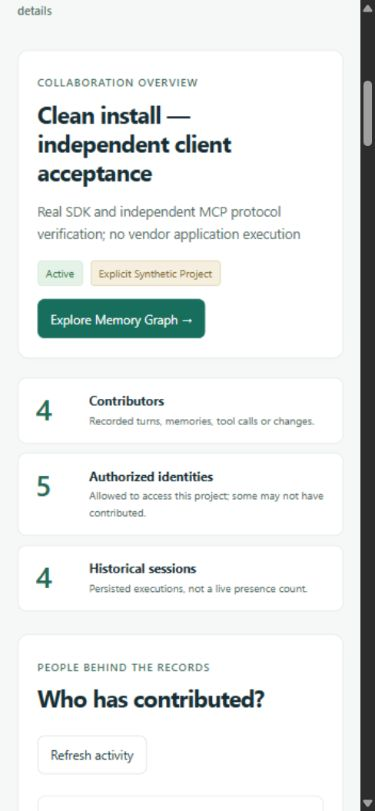

# Loomline 0.2.0 — final user acceptance

**Assessment: GO WITH LIMITATIONS for local teammate evaluation and a Track 2
demonstration.** The portable setup, shared-memory engine and interactive product
experience work against real FalkorDB. Vendor application configuration still
requires the owner. The historical preservation comparison also has an explicit
exception: four empty MCP sessions appeared during the audit; this report does
not claim whole-graph equality.

Product release 0.2.0 retains SDK/MCP package versions 0.1.0 and memory contract
0.1. Existing task IDs, default idempotency receipts and memory semantics remain
compatible. This report records verification before initial source publication;
no hackathon submission was performed.

## Tested environment and package

- Windows host, PowerShell, Docker Desktop Linux containers / Compose v2.
- Docker Python 3.12.10 and Node 22.15.0 bases pinned by digest; FalkorDB 4.14.11
  / Redis 8.2.2 pinned by image digest. Host tooling used Python 3.12.
- Actual source ZIPs were extracted into **three new directories containing
  spaces**, with fresh credentials, namespaces, ports and named database volumes.
  No development virtual environment, profile, database or provider key was copied.
- Final tested candidate: `loomline-product-0.2.0-candidate-3.zip`, 163 members,
  SHA-256 `c3951bb88d9de8fe46c8d3c72afe8039c39b8057905ec3e7f7f0225da4fbe994`.
- The distributable is `loomline-0.2.0-verified.zip` with an adjacent checksum.
  Its runtime, tests, dependency locks and configuration must match that tested
  candidate byte-for-byte. Only documentation and screenshots are updated with
  completed evidence. The release sealing receipt verifies this comparison.

Maintainer evidence is retained privately under
`artifacts/mcp/product_acceptance_20261018/` and
`artifacts/release/product_9be2d4d052884189.json`, plus its additional-test receipt.
These receipts and runtime data are excluded from the public ZIP. A checksum is
transfer integrity evidence, not a substitute for the installation below.

## Complete first-user path — performed

| Step | Actual verification |
|---|---|
| 1. Extract | New, isolated directory; no `.env`, secrets, environments or database shipped. |
| 2. Start | Documented Docker stdlib initializer, Compose build, gateway/router/FalkorDB health passed. |
| 3. Bootstrap | Legitimate coordinator bearer generated privately; bootstrap returned its file path without its value. |
| 4. Open Studio | Deployed packaged UI opened in the in-app browser. |
| 5. Authenticate | Private operator and separate scoped viewer both authenticated. Reload/disconnect cleared page credentials. |
| 6. Named project | CLI created the final acceptance project; browser also created a separate named project with description and status. |
| 7. Separate identity | Three different contributing identities plus a read-only viewer were provisioned with task restrictions. |
| 8. Independent clients | Fresh noneditable SDK/MCP installation; three independent standard MCP clients launched the generated Docker stdio configurations. |
| 9. Write | Real source-linked onboarding episode, decision, proposed hypothesis, procedure and reviewer observation committed. |
| 10. Retrieve | Another principal retrieved the onboarding episode; other MCP identities resolved context/provenance from storage. |
| 11. Visual graph | Actual persisted edges displayed; node/edge selection, type colours, filters, zoom, pan, fit and node dragging checked. |
| 12. Explain retrieval | Memory trace showed source/session/evidence; Graph Query exposed fixed Cypher, parameters, row counts and safe returned samples. |
| 13. Handoff | Independent clients completed open v1 → accepted v2 → done v3; browser separately created and completed a versioned handoff. |
| 14. Restart/recover | Owned database container actually replaced, volume retained, gateway/router restarted; a new Docker MCP session recovered history, context, memories and done handoff. |

Final candidate: **34 automated installation checks passed**. Its memory,
provenance and handoff snapshot matched before/after replacement:
`e9c9daf6fd66a30b57db970c67c13f6cb14aed497f87a5d5093bd6b60f19fa14`.
All three acceptance projects were stopped using `down` **without `-v`**;
their volumes/evidence were retained. The existing local deployment was updated
and its services reported healthy.

The default initializer was also checked **without a project-name override**:
Docker resolved the freshly generated unique project and its corresponding
`graph_data` volume. Two fresh initializations get distinct names; rerunning
initialization preserves an existing `.env` byte-for-byte. This fixes the former
risk of separate extractions sharing Compose's fixed project name.

## Regression, protocol and security results

| Verification | Result |
|---|---|
| Preserved baseline | 46 existing backend/SDK tests passed before implementation. |
| Final backend/SDK | **61 passed**, real FalkorDB, inside final extracted Docker build; 19.24 s. |
| MCP regression | **21 passed, 1 skipped** on Windows; 108.99 s. The skip is a Windows symlink creation restriction. |
| Linux MCP filesystem checks | **4 passed**, including symlink rejection and private profile/token staging. |
| Actual Docker-only protocol preflight | Valid stdio framing, authenticated restricted identity and **all 27 tools** discovered. No host Python required for this command. |
| Packaged independent relay | Three principals and real MCP processes; typed memories, evidence, challenge, procedure approval, work contention/release and completed handoff passed. |
| Native frameworks | Real LangChain `create_agent`, compiled LangGraph, CrewAI `Crew.kickoff` and custom Python processes passed the offline workflow plus independent FalkorDB verification. Four identities; 7 memories; 12 events; disputed hypothesis; completed handoff. |
| Existing demos | Bidirectional two-agent memory exchange and offline incident workflow passed from an extracted package. |
| Authentication/isolation | Missing/invalid bearer 401; viewer mutation 403; unauthorized same-tenant project and other tenant 404. |
| Graph correctness | Real stored edges/type-qualified IDs; safe query samples; task-scoped focus/cursors; readonly queries; viewer/tenant restrictions; 105-memory workload and long-session paging passed. |
| Frontend | Production build passed in host and clean Docker build; graph renderer loaded separately. |
| Browser | Desktop 1440×1000 and mobile 390×844; light/dark, navigation, named creation, real graph/provenance/query inspector, handoff controls and viewer restrictions checked. No horizontal page overflow observed. |
| Dependency audits | Backend lock: 37 packages, zero known vulnerabilities. Standalone MCP: 41, zero known vulnerabilities. npm: zero reported vulnerabilities. |
| Optional framework audit | 153 dependency entries; **6 advisory records in 2 packages**, including one duplicate record. See limitations below. |

The measured independent MCP workload made 104 logical requests across four
processes: 52 reads, 32 writes, 20 replays. Zero errors; 21.48 requests/s;
p50 202.11 ms, p95 317.05 ms. These local figures are not a capacity guarantee.

Graph queries are fixed, parameterized, authenticated and bounded to at most
250 nodes / 400 edges per browser view. The normal page begins with two
memories. Long sessions no longer consume that budget through unrelated turns.
Extreme timezone dates reject with 400. No arbitrary Cypher endpoint was added.

Browser setup exposes nine distinct paths: Codex CLI, Antigravity CLI,
Antigravity IDE, Claude Code, generic MCP, custom Python, LangChain, LangGraph
and CrewAI. Generated settings use the supplied installation path and scoped
profile directory. Gateway preflight identifies the **Studio principal** and
does not attest the selected application; its status clears on project change.

## Screenshots from the packaged deployment

These show **independent protocol acceptance activity**, not vendor application
execution or an LLM-generated investigation. The final acceptance task is
explicitly marked synthetic; its memories and relationships are actual commits.




## Historical preservation exception

The strict before/after graph hash comparison **failed**. Diagnosis established:

- All **189 original MCP calls**, **19 memory traces**, recorded turns,
  handoffs and claims match their captured baseline.
- All **17 original website/source/QA file hashes** match. Those files were
  only read; no website tests or coding operations were executed there.
- All **15 original session records captured in the bounded baseline** remain
  present and unchanged.
- Total historical sessions increased **48 → 52**. The four appended records
  belong to the existing Codex-named principal, declare `framework=mcp`, and
  have **zero turns and zero MCP calls**. The creating process/client is not
  attested; no actual coding application configuration was inspected.

No sessions or original data were deleted/reset to make the comparison pass.
The failed strict comparison and supplemental read-only diagnosis remain in
the private evidence directory. Existing data is retained, but this release
does **not** claim that the original task had zero new activity during the audit.
The owner should review that delta and select a separate MCP task/profile for
future audit chats if the historical project must remain completely frozen.

## Limits and remaining owner/team work

1. **Test your actual applications.** Personally merge the generated settings
   into Codex, Claude Code and Antigravity, invoke genuine Loomline tools and
   record a cross-application handoff/restart. This release verified configuration
   formats and independent protocol clients; it did not launch those applications.
   Earlier owner-confirmed Codex CLI + Antigravity CLI collaboration is separate
   historical evidence. Claude Code, Antigravity IDE and the three-application
   experiment still await the owner's manual verification.
2. **Review the four empty historical sessions** described above. No destructive
   cleanup is required or recommended to demonstrate preservation.
3. **Use private provider configuration for NVIDIA examples.** The clean package
   contains no provider keys. New acceptance used explicit offline policies;
   it never presented them as model inference. Earlier real NVIDIA four-framework
   evidence remains in the implementation notes; inference code was preserved.
   New live inference was not rerun for this UX/portability phase. Handle the
   planned provider credential replacement privately before public operation;
   no credentials were rotated, overwritten or revoked here.
4. **Review optional dependency risk.** ChromaDB 1.5.9 has four unique advisories;
   optional MCP 1.28.1 has CVE-2026-59951. CrewAI constrains that older MCP line.
   The optional lab runs no Chroma server/collections or Streamable HTTP MCP
   server and is isolated from the core and standalone MCP environment. This is
   a reachability assessment, not a clean audit or a patched dependency set.
5. **Verify your teammate's OS and public-operation needs.** Windows-host/Linux-
   container acceptance passed; an actual macOS host and vendor applications
   were not exercised. POSIX configuration/escaping and Linux permissions were
   tested. Keep the default loopback deployment local; remote exposure requires
   deliberate TLS, identity, backup and operational design. One gateway worker
   is the supported topology; no distributed availability or cross-query atomic
   snapshot guarantee is made.
6. **Complete submission yourself.** Review code/license/contributions, record a
   credential-free video, disclose AI assistance, authorize any publication and
   submit the project. No public repository, video or submission is fabricated.

MCP retains explicit turns only. Audit records omit tool arguments/results, so
a recorded retrieval does not prove the exact payload that influenced a decision.
The UI calls that influence author-reported unless further evidence establishes
it. Session metadata and identity names do not prove software identity or live
presence. Claims coordinate principals; they do not lock Git worktrees/files.

## Reproduce

Follow [START_HERE](START_HERE.md) for the Docker-only first-user journey,
[AGENT_SETUP](docs/AGENT_SETUP.md) for all integrations and
[MEMORY_GRAPH_GUIDE](docs/MEMORY_GRAPH_GUIDE.md) for the product controls.

Maintainers with Python 3.12 and Docker can run the packaged acceptance harness:

```sh
python -m scripts.product_acceptance start --archive /absolute/path/to/source-release.zip
python -m scripts.product_acceptance verify --receipt artifacts/release/product_RETURNED_NONCE.json
python -m scripts.product_acceptance restart --receipt artifacts/release/product_RETURNED_NONCE.json
python -m scripts.product_acceptance stop --receipt artifacts/release/product_RETURNED_NONCE.json
```

Use the receipt path actually returned by `start`. The harness creates its own
fresh verification environment and private configuration. It does not control
vendor coding applications. Browser actions are verified separately.

Initial incorrect test invocations were retained: direct MCP pytest was refused
by its namespace safety guard; the supported isolated harness subsequently
passed. A missing temporary parent was corrected before the baseline retry.
First-run Compose build output also required extracting the final program JSON;
the final packaged harness includes and passed that correction. No failing test
was reclassified as a successful database or model operation.
