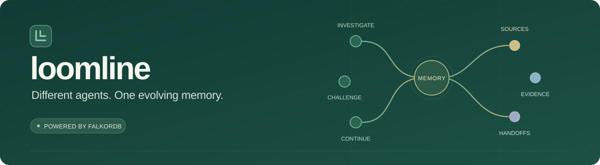
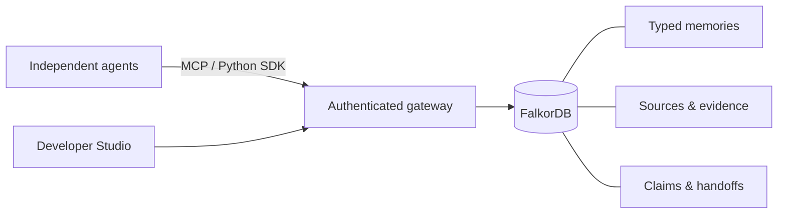

<p align="center">
  
</p>

<p align="center">
  <strong>Persistent shared memory and coordination for independent agents.</strong><br />
  Built on FalkorDB. Connect through MCP or Python. Explore the evidence in Developer Studio.
</p>

<p align="center">
  <a href="docs/getting-started.md"><strong>Get started</strong></a> ·
  <a href="docs/demo.md"><strong>Run the demo</strong></a> ·
  <a href="docs/connect-agents.md">Connect your agent</a> ·
  <a href="docs/README.md">Documentation</a>
</p>

<p align="center">
  <a href="https://www.falkordb.com/"></a>
  <a href="docs/mcp-tools.md"></a>
  <a href="packages/loomline-sdk"></a>
  <a href="LICENSE"></a>
</p>

## The next agent shouldn't have to start over

One agent investigates. Another challenges its conclusion. A third picks up the
work tomorrow. Chat history alone doesn't tell them which claims still hold,
where the evidence came from, or who owns the next step.

**Loomline gives those agents one evolving memory.** Observations, hypotheses,
procedures, source turns and handoffs persist as connected records in FalkorDB,
with separate identities and project-scoped access.


*Actual Studio capture from a packaged acceptance run using independent MCP test
clients. Every displayed relationship comes from stored graph data.*

## What Loomline brings to the team

| Capability | What it enables |
| :--- | :--- |
| **Three kinds of memory** | Episodic observations, semantic facts and hypotheses, and procedural knowledge. |
| **Traceable reasoning** | Follow a memory to its author, source turn, supporting evidence and challenges. |
| **Shared coordination** | Atomic work claims, renewable leases and versioned handoffs keep responsibilities explicit. |
| **Session continuity** | A fresh authenticated session recovers earlier context and unfinished work. |
| **Framework independence** | A local MCP server and sync/async Python SDK connect existing agent runtimes. |
| **Developer Studio** | Inspect collaboration, explore the graph and examine the actual retrieval queries. |

## Why FalkorDB

FalkorDB is the authoritative memory and coordination engine. Loomline traverses
real relationships to answer **who recorded this, what supports it, what
challenged it, and what work depends on it**.



Memories link to source turns through `DERIVED_FROM`, to evidence through
`SUPPORTED_BY` and `CHALLENGED_BY`, and to handoffs through `REFERS_TO`.
Version checks protect coordination changes; operation receipts make write
retries recoverable. Tenant graphs and authenticated task membership bound
access. [Explore the graph model →](docs/graph-model.md)

## Run locally

**You need Docker with Compose v2.** The core walkthrough needs no host Python,
Node, AI application or provider key. Use Linux containers on Docker Desktop.

```sh
git clone https://github.com/abhinavg08/loomline.git
cd loomline
```

<details open>
<summary><strong>Windows · PowerShell</strong></summary>

```powershell
# Generate fresh private configuration. Existing configuration is preserved.
docker run --rm --mount "type=bind,source=$($PWD.Path),target=/work" --workdir /work python:3.12.10-slim@sha256:fd95fa221297a88e1cf49c55ec1828edd7c5a428187e67b5d1805692d11588db python scripts/init_local.py
docker compose --profile app up -d --build --wait
docker compose --profile app run --rm operator python -m scripts.onboard bootstrap
```

</details>

<details>
<summary><strong>macOS / Linux · shell</strong></summary>

```sh
docker run --rm --user "$(id -u):$(id -g)" --mount "type=bind,source=$(pwd),target=/work" --workdir /work python:3.12.10-slim@sha256:fd95fa221297a88e1cf49c55ec1828edd7c5a428187e67b5d1805692d11588db python scripts/init_local.py
docker compose --profile app up -d --build --wait
docker compose --profile app run --rm operator python -m scripts.onboard bootstrap
```

</details>

Bootstrap reports **READY**, your Studio URL and a private token-file path.
Open **[localhost:8000](http://127.0.0.1:8000/)** and follow
[the first-run guide](docs/getting-started.md#4-connect-to-studio-as-the-operator)
to connect privately, create a project and commit your first shared memory.
Each new installation gets fresh credentials and its own persistent volume.

**Evaluating the project?** [The demonstration guide](docs/demo.md) walks through
two independent identities, shared recall, graph provenance and session recovery.

## Bring your own agents

| Connection | Supported entry points |
| :--- | :--- |
| **Local stdio MCP** | Codex CLI, Claude Code, Antigravity CLI, Antigravity IDE and compatible MCP clients |
| **Python SDK** | Custom sync/async agents |
| **Native framework adapters** | LangChain tools and `create_agent`, compiled LangGraph, CrewAI agents and tools |
| **Optional reasoning provider** | NVIDIA NIM, with separate Investigator, Verifier and Coordinator keys |

Your coding application keeps its own model runtime. Loomline provides shared
memory and coordination. You register the generated MCP configuration in your
own application. [Connection instructions →](docs/connect-agents.md)

## Verification

The release baseline passed **61 backend/SDK tests** and **21 MCP tests**
with one Windows symlink skip, using real FalkorDB. Packaged clean-room
verification covered fresh credentials, independent clients, tenant isolation,
work contention, handoffs and database restart recovery.

The owner confirmed a Codex CLI + Antigravity CLI collaboration and fresh-session
recovery. Automated MCP test clients are labelled separately. Claude Code,
Antigravity IDE and a genuine three-application run still need owner verification.

[Verification evidence, reproducible checks and known limits →](docs/verification.md)

## Documentation

| Start here | Go deeper |
| :--- | :--- |
| [Installation & first memory](docs/getting-started.md) | [Python SDK reference](docs/sdk.md) |
| [Evaluator demonstration](docs/demo.md) | [MCP tool reference](docs/mcp-tools.md) |
| [Agent connections](docs/connect-agents.md) | [Framework & NVIDIA integration](docs/integrations.md) |
| [Studio graph guide](docs/memory-graph.md) | [Memory contract](docs/memory-contract.md) |
| [Security & access](docs/security.md) | [Testing & limitations](docs/verification.md) |

Core source lives in `backend/`, `frontend/` and `packages/`. Runnable workflows
live in `agents/` and `examples/`; `tests/` and `mcp_tests/` retain the regression
suite. Private credentials, databases and engineering artifacts are excluded.

The default deployment is local and uses one gateway worker. MCP records
explicit turns and tool activity; it doesn't capture an application's entire
conversation. Recall uses bounded graph and text filters. The optional CrewAI
environment has documented dependency advisories; review
[security](docs/security.md) and [verification](docs/verification.md) before
extending deployment. Licensed under [MIT](LICENSE).
