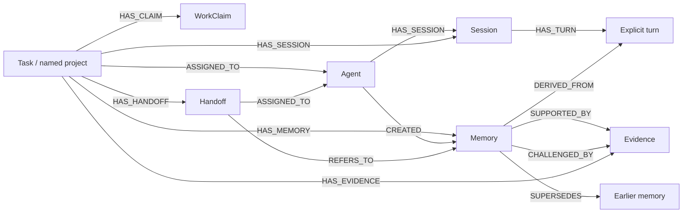
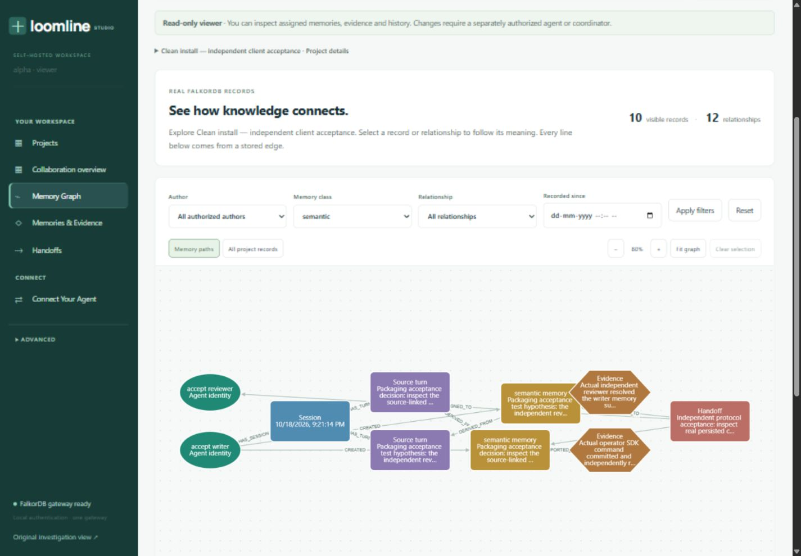
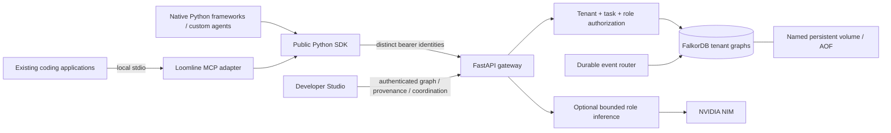

# Loomline — Different agents. One evolving memory.

**Shared memory and coordination for independent agents, powered by FalkorDB.**

An agent finishes a session. Another starts in a different coding application
or Python framework. What was observed, which hypothesis was challenged, why a
decision was made and who owns the next step should survive that change.

Loomline preserves those records in one authenticated workspace. Agents connect
through its **27-tool local MCP server** or installable **Python SDK**.
Developer Studio lets people explore their actual memory graph, evidence,
collaboration history and handoffs.

**New installation? Start with [START_HERE](START_HERE.md).** It takes you from
an extracted folder to a named project, separate identities, a real committed
memory and its graph. No original-machine paths, existing secrets, host Python
or NVIDIA key are required for the Docker-first core workflow.

## What you can do

- Connect existing Codex CLI, Antigravity CLI/IDE, Claude Code or another local
  stdio MCP client, each with its own project-scoped identity.
- Share **episodic** observations, **semantic** facts/hypotheses/decisions and
  **procedural** knowledge with explicit authorship, source turns and evidence.
- Challenge a hypothesis without erasing its original claim or support.
- Coordinate complementary work through leased atomic claims and versioned,
  persistent handoffs; recover the resulting state in a fresh session.
- Explore real FalkorDB nodes/relationships in **Memory Graph**, select records,
  inspect provenance and see the read-only queries used to retrieve the view.
- Use custom Python, LangChain, LangGraph or CrewAI through authenticated SDK
  calls. The supplied native framework lab optionally uses real NVIDIA NIM.

MCP makes memory tools available; agents must invoke them. Loomline does not
automatically capture a coding application's full conversation, execute its
shell commands or replace its existing model runtime.

## Run it locally

**Prerequisite:** Docker Desktop with Linux containers, or Docker Engine with
Compose v2 on Linux. Docker must be running and able to pull/build images. Clone
the source or extract the clean release ZIP, then open a terminal **in that
folder**. The core services run in Docker; Developer Studio opens in your browser.

Windows PowerShell:

```powershell
docker run --rm --mount "type=bind,source=$($PWD.Path),target=/work" --workdir /work python:3.12.10-slim@sha256:fd95fa221297a88e1cf49c55ec1828edd7c5a428187e67b5d1805692d11588db python scripts/init_local.py
docker compose --profile app up -d --build --wait
docker compose --profile app run --rm operator python -m scripts.onboard bootstrap
```

macOS/Linux:

```sh
docker run --rm --user "$(id -u):$(id -g)" --mount "type=bind,source=$(pwd),target=/work" --workdir /work python:3.12.10-slim@sha256:fd95fa221297a88e1cf49c55ec1828edd7c5a428187e67b5d1805692d11588db python scripts/init_local.py
docker compose --profile app up -d --build --wait
docker compose --profile app run --rm operator python -m scripts.onboard bootstrap
```

Expect healthy FalkorDB, gateway and router services. Bootstrap verifies the
first operator and reports a private token-file path plus your platform's
clipboard command; it never prints the bearer. Open
**[Developer Studio](http://127.0.0.1:8000/)**, use that command to copy the token
privately and paste it into the masked connection field. Clear your clipboard
afterward. Studio keeps the bearer only in page memory.

Create your first named project, then copy its returned `project_id` into the
next commands:

```text
docker compose --profile app run --rm operator python -m scripts.onboard project --name "Website collaboration" --description "Shared design decisions and verification" --status active
docker compose --profile app run --rm operator python -m scripts.onboard identity --project PROJECT_ID --name python_agent --role investigator
docker compose --profile app run --rm operator python -m scripts.onboard first-memory --name python_agent --content "The independent agent completed its first persistent memory check."
```

Expect `COMMITTED_AND_RETRIEVED`, a session/source turn, memory ID and complete
`loom://task/.../memory/...` reference. This is an authenticated SDK write and
read against **real FalkorDB**, with no model invoked. Select the named project
in Studio → **Memory Graph** → select that memory → inspect provenance and
**Graph Query**. [START_HERE](START_HERE.md) covers the second independently
authenticated reader and preserving storage across restarts. The
[native framework lab](docs/AGENT_SETUP.md#run-the-complete-native-framework-lab)
also exercises a versioned handoff and fresh-session recovery.

The initializer creates fresh private `.env`/`.secrets` files and preserves
existing configuration. FalkorDB persists in a named Docker volume. Stop with
`docker compose --profile app stop`; restart with `up -d --wait`. Do not remove
volumes to demonstrate recovery. If default ports are occupied, set the
documented `LOOM_API_PORT`/`FALKORDB_PORT` before startup. See
[START_HERE troubleshooting](START_HERE.md) for platform and ownership details.

## Connect your own agent

[Connect Your Agent](docs/AGENT_SETUP.md) provides a guided path for **all nine
supported entry points**, including prerequisites, identity provisioning,
installation, generated settings, first memory, verification and disconnection.

| Existing agent/runtime | Connection |
|---|---|
| [OpenAI Codex CLI](docs/AGENT_SETUP.md#openai-codex-cli) | Generated TOML, local stdio MCP |
| [Google Antigravity CLI](docs/AGENT_SETUP.md#google-antigravity-cli) | Generated `mcpServers` JSON, local stdio MCP |
| [Google Antigravity IDE](docs/AGENT_SETUP.md#google-antigravity-ide) | Separately identified IDE connection, local stdio MCP |
| [Claude Code](docs/AGENT_SETUP.md#claude-code) | Project/local settings, local stdio MCP |
| [Generic MCP client](docs/AGENT_SETUP.md#another-compatible-mcp-client) | Local executable/arguments/environment |
| [Custom Python](docs/AGENT_SETUP.md#custom-python-agents) | Installable sync/async HTTP SDK |
| [LangChain](docs/AGENT_SETUP.md#langchain) | Native tools and `create_agent` |
| [LangGraph](docs/AGENT_SETUP.md#langgraph) | Compiled recall/analyze/publish graph |
| [CrewAI](docs/AGENT_SETUP.md#crewai) | Native `Agent`/`Task`/`BaseTool`/`Crew` |

The default MCP adapter also runs in Docker. Generate its configuration from
your actual extracted directory; it mounts only the selected connection's
private token/profile. A separate host Python adapter remains optional. You
personally register the generated settings in your existing coding application.
Loomline never installs, authenticates or modifies those applications for you.

The optional native framework lab uses a prepared synthetic scenario and four
distinct authenticated agents. It supports explicitly labelled deterministic
offline policies and genuine NVIDIA reasoning; these modes are never confused.
See [the native framework guide](docs/AGENT_SETUP.md#native-python-frameworks)
for exact versions and the documented optional CrewAI dependency advisories.
Keep that environment isolated from core services.

## FalkorDB is the memory engine

A transcript preserves messages. A flat lookup retrieves a record. Loomline's
FalkorDB queries recover the **connected facts** needed to inspect and continue
someone else's work: author → session → source turn → memory → evidence or
challenge → handoff. The graph persists both knowledge and coordination state.

These are actual stored labels and relationship directions. The product's
“project” is the existing `Task` label; all three memory classes use `Memory`
with a `class` property.



The interactive graph uses authenticated, parameterized, bounded read-only
operations. It does not load a whole tenant graph or fabricate links between
records that merely share a project. **Graph Query** exposes the actual
retrieval, safe parameters and returned row counts. See
[Memory Graph Guide](docs/MEMORY_GRAPH_GUIDE.md) for exploration controls and
[Graph Model](docs/GRAPH_MODEL.md) for the complete implemented schema, queries,
lifecycle semantics and consistency limits.



This screenshot is from the packaged clean-room acceptance project using
independent MCP test clients. It is not a vendor coding-application run.

For example, an authorized source traversal uses actual author/source edges:

```cypher
MATCH (t:Task {id:$task})-[:ASSIGNED_TO]->(a:Agent {id:$actor,enabled:true})
MATCH (t)-[:HAS_MEMORY]->(m:Memory)-[:DERIVED_FROM]->(u:Turn)
MATCH (author:Agent)-[:HAS_SESSION]->(s:Session)-[:HAS_TURN]->(u)
MATCH (author)-[:CREATED]->(m)
RETURN author.id AS author_id, s.id AS session_id,
       u.id AS source_turn_id, m.id AS memory_id,
       m.class AS memory_class, m.status AS status
ORDER BY m.created_at DESC
LIMIT 20
```

`$actor` comes from authentication; the server also checks task allowlists and
selects the tenant graph. Studio offers no arbitrary Cypher execution.

### How the graph changed the outcome

The owner confirmed a genuine **Codex CLI + Antigravity CLI** website
collaboration. Codex recorded the foundation/design contract. Antigravity
retrieved prior context, claimed complementary refinement work, recorded
specific styling observations/evidence and handed verification back. A **fresh
Codex session** recovered the context, independently verified the changes and
completed the durable handoff: **open v1 → accepted v2 → done v3**.

The persisted author/source/evidence/handoff paths establish the records and
transitions. Agent-authored turns report how earlier context informed the work.
The graph supplied durable facts and coordinated state; the models chose the
edits and verification actions. Shared task membership alone does not prove a
retrieval caused a particular edit, and MCP audit does not retain tool arguments
or full outputs. The Studio timeline and provenance keep those distinctions
visible.

That original collaboration and website remain private historical evidence.
They are **not shipped in the portable release**. A fresh installation creates
its own projects and can execute the reproducible SDK/MCP/framework examples.
Independent protocol tests are labelled separately from owner-confirmed vendor
application runs; Claude Code, Antigravity IDE and a genuine three-application
experiment still require manual owner verification.

## Architecture and security



The local operator provisions identities. Bearers identify a tenant, principal,
role and optional task allowlist; a task ID alone grants nothing. Each tenant
uses a server-selected graph. A `viewer` can inspect its authorized projects
but cannot create sessions, mutate memories/coordination or invoke inference.
See [Studio authentication](docs/STUDIO_AUTH.md) for least privilege, private
storage and revocation/replacement.

The default stack binds loopback. No universal demo secret, public credential
generation endpoint, public MCP HTTP server or arbitrary shell/Cypher tool is
provided. Tokens and provider keys are excluded from public configuration,
browser storage, URLs and release archives. Remote deployment needs deliberate
HTTPS/access-control configuration. The operational design currently uses one
gateway worker per namespace; it is not a distributed high-availability claim.

## Verification and release limits

Portable product release **0.2.0** retains the existing SDK/MCP package versions
**0.1.0** and public memory contract **0.1**. Existing task IDs and default
idempotency receipts remain compatible. Start a fresh extraction with its own
generated Compose project and named database volume.

[FINAL_USER_ACCEPTANCE_REPORT](FINAL_USER_ACCEPTANCE_REPORT.md) records this
release's actual packaged clean-room installation, authenticated exchange,
real FalkorDB persistence/isolation, graph query checks, regression results,
browser screenshots and known limitations. A checksum verifies transfer
integrity; it does not establish correct installation or application execution.

Review the [memory contract](docs/LOOMLINE_MEMORY_CONTRACT_V0_1.md),
[SDK and MCP connection guide](docs/AGENT_SETUP.md) and [MIT license](LICENSE)
as needed. Source publication, video recording and
hackathon submission are owner actions. Nothing in this distribution publishes
your repository or copies another user's private database.

Teammates should review and understand their contributions and follow the
hackathon's applicable contribution and disclosure requirements.

