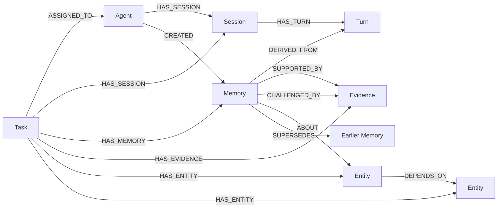
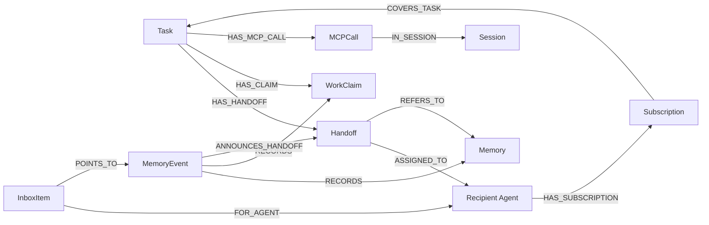

# Loomline graph model

FalkorDB is Loomline's authoritative storage and relationship engine. This document follows the actual [schema](../backend/app/schema.py), [repository](../backend/app/repository.py), [platform routes](../backend/app/platform.py), [coordination routes](../backend/app/coordination.py), [read-only graph explorer](../backend/app/graph_view.py) and [event router](../backend/app/router.py). Start with [the visual graph guide](MEMORY_GRAPH_GUIDE.md) for the Studio controls.

The diagrams describe the implemented model. They do not imply every edge appears on every task: a blank coding task may have no dependency entities, a memory may have no supporting evidence yet, and a handoff may reference no memories.

## Authorization and storage boundary

The gateway constructs `TenantContext` from an opaque bearer token's hash in the private registry. [Database.graph](../backend/app/db.py) chooses the graph from server configuration. Ordinary local graphs are `loom_t_alpha` and `loom_t_beta`; isolated test/release namespaces use different names. There is **no `Tenant` node** or client argument selecting an arbitrary graph.

Task access requires both the credential's optional `allowed_task_ids` restriction and the graph membership match:

```cypher
MATCH (t:Task {id:$task})-[:ASSIGNED_TO]->(a:Agent {id:$actor,enabled:true})
```

`$actor` comes from authentication. Session writes additionally match the authenticated session owner; evidence and memory references must belong to the authorized task. Membership does not override role or procedure-approval restrictions. A Studio viewer can read assigned task records but cannot mutate them.

## Knowledge and provenance



`DERIVED_FROM` points from memory to its source turn. Evidence source information is stored in `source_type`, `source_ref` and `observed_at`; there is no `Evidence → Turn` edge. Evidence is immutable through the public API. Authorship is represented by `Agent → CREATED → Memory` and the memory's `created_by` property.

All classes use **`Memory`**, distinguished by `class`: `episodic`, `semantic` or `procedural`. There are no separate `Hypothesis`/`Procedure` labels. Those meanings live in `assertion_type`, `status` and bounded procedure `steps_json`.

## Coordination, events and activity



`Handoff.from_agent_id` records the sender; its **`ASSIGNED_TO` edge targets the recipient**. `WorkClaim.owner_agent_id` is a property, not an ownership edge. Events refer to tasks through `task_id`; there is no `Task → HAS_EVENT` relationship. `Operation` receipts are indexed property records without graph edges.

MCP activity stores tool name, outcome, safe error code, duration, actor, session and sequence. It deliberately omits tool arguments, output payloads, credentials and hidden reasoning. Client/framework names are self-declared metadata, not proof of which application binary ran.

## Actual labels and notable properties

Each of these 14 labels has an `id` range index and unique `id` constraint. Bootstrap waits for readiness before serving. Uniqueness is **per label within a tenant graph**, rather than across labels or tenants. The explorer therefore uses a presentation key such as `Memory:mem_...`, keeping the original `id` separately. Its traversal queries use actual database node identity within each request: a same-ID `Agent` cannot be merged with a `Memory`, or trick a task-membership check.

| Label | Main properties and role |
|---|---|
| `Agent` | `id`, `role`, `enabled`, `created_at`; task membership and credential-derived identity. Bearer values are not stored here. |
| `Task` | `id`, `title`, optional `description`, `status`, `version`, timestamps; `event_seq`/`mcp_seq` when allocated; optional synthetic/demo flags. A project is a task with a human-readable title, not a separate node label. |
| `Session` | `id`, `task_id`, `agent_id`, `status`, `next_seq`, `started_at`; optional self-declared framework/version. |
| `Turn` | `id`, `session_id`, `seq`, `role`, `content`, `content_hash`, optional tool metadata, `operation_id`, timestamp. |
| `Memory` | `id`, `class`, `assertion_type`, `status`, `content`, optional `steps_json`, `task_id`, `created_by`, `source_turn_id`, `version`, timestamps, `operation_id`. |
| `Evidence` | `id`, `task_id`, `source_type`, `source_ref`, `content`, `observed_at`, `created_at`. |
| `Entity` | `id`, `name`, `entity_type`; domain subjects and dependencies. |
| `Operation` | `id`, `kind`, `task_id`, `actor_id`, canonical `payload_hash`, `result_json`, timestamp; applicable writes add result identifiers/allocated sequence. |
| `MemoryEvent` | `id`, `task_id`, `seq`, `type`, `actor_id`, `target_kind`, `target_id`, `operation_id`, timestamp, lifecycle status/version/reason fields and durable dispatch state. Older unsequenced events remain readable outside the ordered change feed. |
| `Handoff` | `id`, `task_id`, `from_agent_id`, `to_agent_id`, `description`, `status`, `version`, `operation_id`, timestamps. |
| `WorkClaim` | `id`, `task_id`, `key`, `owner_agent_id`, `state`, `version`, `lease_until_ms`, `updated_at`. |
| `Subscription` | `id`, `agent_id`, `task_id`, `enabled`, `created_at`. |
| `InboxItem` | `id`, `agent_id`, `task_id`, `event_id`, `status`, `created_at`; a durable pointer rather than a copied memory payload. |
| `MCPCall` | `id`, `seq`, `task_id`, `session_id`, `agent_id`, `tool_name`, `outcome`, `error_code`, `duration_ms`, `created_at`, `transport`, `attestation`. |

## Memory lifecycle and consistency

| Class | Initial assertion/status | Later changes |
|---|---|---|
| Episodic | `episode`/`observation`, active | New linked replacement; explicit old-record supersession after a replacement exists. |
| Semantic | `observation`/`decision` active; `hypothesis` proposed | Challenge adds contrary evidence and makes a hypothesis disputed. Support adds evidence/version without changing status. Replacement/supersession preserves history. |
| Procedural | `procedure`, proposed, nonempty bounded steps | Authorized coordinator approval → active; proposed/active → retired. Coding MCP identities are denied approval by backend policy. |

Memory content/source are not silently edited. Lifecycle mutations update status/version and append events. Creating `new → SUPERSEDES → old` does not itself mark the old record superseded; that is a separate version-checked write. Context excludes retired procedures; historical resolution still works. Semantic context may include superseded records and exposes their status.

One memory-creation modifying query commits `Operation`, `Memory`, task/author/source edges, optional evidence/entity/replacement links and the pending creation event. Required foreign records match before creation. SDK/MCP convenience operations first commit a source turn, then memory: those **two commits are not one transaction**.

Same-graph modifying queries serialize. Turns allocate their sequence in the same modifying query as the turn/receipt; lifecycle events similarly allocate `Task.event_seq`. Version checks fence stale mutations. Canonical intent hashes and operation receipts make retries recoverable. Replaying an old lease operation returns its original result: refresh current ownership before acting.

Context/trace/history use bounded per-query snapshots, not one cross-query atomic snapshot. The router durably freezes recipients, upserts inbox pointers and marks dispatch in separate queries. Delivery is eventual/at least once, not synchronous or exactly once.

## Explore your own project without changing it

Open Studio, authenticate with a project-scoped viewer, select the project by title, and open **Memory Graph**. Selecting or expanding a node makes authenticated `GET` requests only. These requests do not initialize MCP, create sessions, invoke a model, or append tool activity. A fresh installation has its own empty database and credentials; no original developer task or private profile is required.

An optional host-side command can inspect the same public SDK trace operations. First install the SDK and MCP package following [agent setup](AGENT_SETUP.md), then run from the extracted source root:

```text
python -m scripts.inspect_demo_graph --task-id YOUR_PROJECT_ID --profile .secrets/connections/agent/host.profile.json
```

Use the actual task ID and private profile path issued by your installation. The command reads the token file privately and uses HTTP reads; it does not initialize an MCP server. Public exports exclude credentials, profiles and graph data. Inspect ordinary memory/evidence text before sharing screenshots because the content itself can be private.

`resolve`/`trace` accept **memory** references such as `loom://task/YOUR_PROJECT_ID/memory/YOUR_MEMORY_ID`. Evidence is available through its linked memory trace. Unsupported/malformed references return `400 INVALID_MEMORY_REFERENCE`; well-formed absent/inaccessible memories remain `404`.

## Visual graph API and query inspector

`GET /v1/tasks/{task}/graph` is a fixed, parameterized operation. Authentication constructs the tenant context; `Repository.authorize` enforces both task allowlist and enabled membership before any graph query. Reads use the driver's `ro_query` path. Neither the browser nor an agent can provide arbitrary Cypher, a graph name or an alternate authenticated actor.

| Parameter | Behavior |
|---|---|
| `limit` | Primary memory page size, default 20, range 1–40. |
| `before` | Opaque next-page cursor. Bound to operation, tenant, authenticated agent, task and filters; changing filters requires starting a new page. |
| `agent_id` | Select memory seeds authored by this identity and session/claim/handoff/tool-call context associated with it. This is a search filter, never impersonation. |
| `memory_class` | Select episodic, semantic or procedural primary memory seeds. |
| `relationship` | Show only one implemented relationship type. Other edge types are omitted rather than relabeled. |
| `since` | Lower timestamp boundary with a required timezone, such as `2026-10-18T00:00:00Z`. |
| `focus` | An existing task-scoped raw node ID; selects its neighborhood instead of a primary memory page. |
| `focus_type` | Optional actual label such as `Memory` or `Turn`; required when different labels share a raw ID. Ambiguous untyped focus returns `400 AMBIGUOUS_FOCUS`. |

The response contains:

- `task`: original project metadata, including its title and internal ID.
- `nodes`: actual records with `{key, id, type, label, properties}`; memories add their full `uri`.
- `edges`: actual stored relationships with `{id, source, target, type, meaning}`. `source`/`target` are type-qualified node keys; `source_id`, `target_id`, `source_type` and `target_type` preserve original identity details.
- `memory_page_ids`, `next_cursor`: identify the exact primary memory page. Linked context can include older memories outside that page; it is not fabricated or silently reclassified.
- `queries`: the exact backend-defined Cypher and parameters actually executed, result row counts, up to five `returned_records` samples, `sample_truncated` and `read_only: true` for **How this was retrieved**. Those parameters contain authenticated IDs and selected record IDs, never bearer values or database credentials. Samples preserve actual node keys/types/readable labels; the graph contains the fuller returned presentation records.
- `bounds` and `interpretation`: explain truncation, scope and the limits of causal inference.

The explorer fetches at most **250 displayed nodes and 400 displayed edges**, at most **two adjacent expansion hops**, and up to eight recent context records per type. Assigned identities have a 100-record display cap. Each adjacent-edge query is capped at 401 rows, using the extra row to detect truncation. Primary memory pagination provides progressive loading; selecting an existing record provides focused expansion. `bounds.truncated` must remain visible rather than implying a complete task graph.

Every neighboring node is checked against the selected task. An agent's sessions in another task and another task's membership in a shared entity are excluded. `Operation`, inbox dispatch internals and token registries are not presentation graph nodes. Stored provenance text is untrusted content, not an instruction to the viewer or coding agent.

The inspector presents **read operations**, not an explanation invented by a model. It shows how a browser/SDK traversal retrieved records. The bounded context endpoint is a separate operation used by SDK/MCP tools; a graph view alone does not prove that a particular model saw a particular memory.

## Collaboration facts and timeline

`GET /v1/tasks/{task}/collaboration?limit=40` returns independently computed `authorized_agents`, `contributors`, `counts` and a paged `timeline`:

- Authorized agents have current enabled task membership. Authorization does not assert contribution or connection.
- Contributors have actual stored turns, authored memories through `CREATED`, adapter-reported MCP calls or lifecycle-event activity. A session with no such activity is counted as a session, not sufficient by itself for contributor status. Counts retain historical actors whose authorization was later removed.
- Sessions are historical executions. `last_activity_at` reports a stored timestamp; it does not establish live presence.
- Timeline entries derive from actual memories, session starts, lifecycle transitions and MCP tool-call reports. Each entry retains the original record and, when applicable, the memory URI for provenance inspection.
- A synthetic task flag or explicit `TEST-CLIENT` content marks test activity. An agent name containing a client brand does **not** verify the application. Unmarked records remain application-unverified instead of being promoted to genuine coding-client evidence.

Timeline queries have a maximum page size of 100 and newest-first cursors bound to identity, tenant, task and filters. Contributor aggregates are bounded to 100 actors per category; `aggregates_truncated` reports when that limit is reached.

The system can verify **who authenticated, what was stored, actual source/evidence edges, successful adapter-reported tool outcomes, and handoff versions**. Existing MCP call records intentionally omit arguments and outputs, so a successful recall call cannot identify exactly which returned memory influenced a later action. Such a statement remains **agent-reported**, with the source turn available for inspection. Task co-membership is never drawn as a `USED_CONTEXT` or `INFLUENCED` edge.

## Read-only Cypher examples

These parameterized queries match implemented edges. They are for an authorized **local database operator** using `GRAPH.RO_QUERY` / the driver's `ro_query`. Agent SDK/MCP credentials do not grant raw database access; use the public inspector for ordinary inspection. Never put a database password in public commands or URLs.

Bind `$task`, credential-derived `$actor` and selected `$mid`/`$hid` as needed. The gateway also enforces the credential task allowlist; a copied membership pattern does not replace that policy.

### 1. Which agent and session produced each memory?

```cypher
MATCH (t:Task {id:$task})-[:ASSIGNED_TO]->(a:Agent {id:$actor,enabled:true})
MATCH (t)-[:HAS_MEMORY]->(m:Memory)-[:DERIVED_FROM]->(u:Turn)
MATCH (author:Agent)-[:HAS_SESSION]->(s:Session)-[:HAS_TURN]->(u)
MATCH (author)-[:CREATED]->(m)
RETURN author.id AS author_id, s.id AS session_id,
       u.id AS source_turn_id, m.id AS memory_id,
       m.class AS memory_class, m.status AS status
ORDER BY m.created_at DESC
LIMIT 20
```

This follows actual source/author relationships rather than trusting a name embedded in prose.

### 2. What supports or challenges this memory?

```cypher
MATCH (t:Task {id:$task})-[:ASSIGNED_TO]->(a:Agent {id:$actor,enabled:true})
MATCH (t)-[:HAS_MEMORY]->(m:Memory {id:$mid})-[:DERIVED_FROM]->(u:Turn)
MATCH (s:Session)-[:HAS_TURN]->(u)
OPTIONAL MATCH (m)-[r:SUPPORTED_BY|CHALLENGED_BY]->(e:Evidence)<-[:HAS_EVIDENCE]-(t)
RETURN m.id AS memory_id, s.id AS session_id, u.id AS source_turn_id,
       e.id AS evidence_id, type(r) AS relationship
LIMIT 20
```

An absent evidence edge does not become invented support. API trace also returns lifecycle events, supersession links and related handoffs in separate bounded queries.

### 3. Who moved the handoff through its versions?

```cypher
MATCH (t:Task {id:$task})-[:ASSIGNED_TO]->(a:Agent {id:$actor,enabled:true})
MATCH (t)-[:HAS_HANDOFF]->(h:Handoff {id:$hid})-[:ASSIGNED_TO]->(recipient:Agent)
MATCH (ev:MemoryEvent)-[:ANNOUNCES_HANDOFF]->(h)
RETURN h.id AS handoff_id, recipient.id AS recipient,
       ev.type AS event, ev.new_status AS status,
       ev.new_version AS version, ev.actor_id AS actor
ORDER BY ev.created_at, ev.id
LIMIT 20
```

Event actors/versions retain the transition trail after the original process exits. The recipient accepts/completes; authorized cancellation is a separate transition.

### 4. Which claims coordinated the work?

```cypher
MATCH (t:Task {id:$task})-[:ASSIGNED_TO]->(a:Agent {id:$actor,enabled:true})
MATCH (t)-[:HAS_CLAIM]->(w:WorkClaim)
MATCH (ev:MemoryEvent {task_id:$task})-[:RECORDS]->(w)
RETURN w.key AS work_key, w.owner_agent_id AS current_owner,
       w.state AS current_state, ev.type AS event,
       ev.actor_id AS actor, ev.new_version AS version
ORDER BY ev.created_at, ev.id
LIMIT 30
```

Lease activity is computed against the server clock. Current-owner fields describe the present record; event actors describe historical actions. Claims coordinate principals, not filesystem writes or exclusive ownership by individual sessions sharing one token.

### 5. Dependency reasoning in the separate incident/framework fixture

This is the actual `decision_context` traversal shape from `repository.py`. Bind `$entity` such as `checkout`; rows require existing dependency, subject and evidence edges:

```cypher
MATCH (t:Task {id:$task})-[:ASSIGNED_TO]->(a:Agent {id:$actor,enabled:true})
MATCH (t)-[:HAS_ENTITY]->(service:Entity {id:$entity})-[:DEPENDS_ON]->(upstream:Entity)
MATCH (t)-[:HAS_ENTITY]->(upstream)
MATCH (t)-[:HAS_MEMORY]->(m:Memory)-[:ABOUT]->(subject:Entity)
WHERE subject=service OR subject=upstream
MATCH (m)-[r:SUPPORTED_BY|CHALLENGED_BY]->(e:Evidence)
MATCH (t)-[:HAS_EVIDENCE]->(e)
RETURN service.id AS service_id, upstream.id AS upstream_id,
       m.id AS memory_id, e.id AS evidence_id, type(r) AS relationship
ORDER BY m.created_at DESC, e.observed_at
LIMIT 20
```

Incident telemetry is synthetic even when inference is live. The NL website task need not contain these incident entities. Native framework tools receive graph facts; the model selects a validated proposal, then tools execute separate SDK mutations. The graph does not perform the model's reasoning.

## Verification and remaining limits

[Real-database graph tests](../tests/test_graph_view.py) create source-linked memories, evidence, a disputed hypothesis and a handoff through the actual public API. They compare displayed relationships with stored FalkorDB edges, instrument the real read path to reject writes, and check unchanged database snapshots after reads. They cover task assignment, token task restrictions, separate tenants, read-only viewers, paging/filter validation, type-qualified ID collisions and a 105-memory API-created workload with bounded output. They do not substitute mocks for storage.

The [current acceptance report](../FINAL_USER_ACCEPTANCE_REPORT.md) records the final complete release checks. Benchmark thresholds in tests are regression guards on the tested local environment, not universal latency guarantees. A graph request uses several independently consistent read queries, rather than a single cross-query atomic snapshot. Concurrent writes can therefore become visible across different query steps; refresh after a mutation and use lifecycle versions for coordination decisions.

Client/framework metadata is self-declared until independently confirmed by the application owner. Authenticated authorship proves which principal wrote a record, not the truth of every statement in its content or which application binary ran. No graph visualization can manufacture a missing retrieval-to-decision link.
